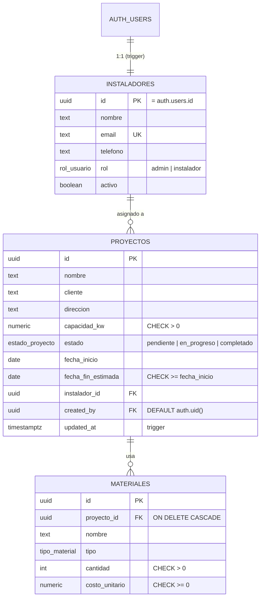

# EcoFlow · Documento de Arquitectura

## 1. Resumen

EcoFlow es una aplicación interna para gestionar proyectos de instalación de paneles solares. El frontend usa **React 19 + TypeScript + Vite**, con **Tailwind CSS v4** y componentes estilo **shadcn/ui**. El backend es **Supabase**: PostgreSQL, Auth, Row Level Security y Realtime. Hay dos roles: el **admin** crea, asigna y ve todos los proyectos; el **instalador** solo ve sus proyectos asignados y puede cambiar su estado.

## 2. Diagrama de la base de datos



Decisiones clave:
- Los estados y tipos son **ENUM** de Postgres, así ningún dato inválido llega a la tabla.
- Las reglas de negocio viven como **CHECK** en la base de datos y se repiten en el frontend con Zod (defensa en profundidad).
- Un trigger crea la fila en `instaladores` cuando un usuario se registra en Supabase Auth.
- La vista `resumen_proyectos` (`security_invoker = true`) junta el instalador, la cantidad de materiales y su costo, y respeta el RLS de quien la consulta.

## 3. Políticas de seguridad (RLS)

| Tabla | SELECT | INSERT | UPDATE | DELETE |
|---|---|---|---|---|
| `proyectos` | asignado o admin | solo admin | asignado o admin* | solo admin |
| `materiales` | si puede ver el proyecto | asignado o admin | asignado o admin | asignado o admin |
| `instaladores` | su propio perfil o admin | admin | propio (sin cambiar rol) o admin | admin |

\* Un trigger (`proteger_campos_proyecto`) impide que un instalador cambie algo distinto del estado y las notas, por ejemplo reasignarse el proyecto a otro instalador.

```sql
create policy "proyectos: ver asignados o admin"
  on public.proyectos for select to authenticated
  using (instalador_id = auth.uid() or public.es_admin());
```

Las políticas se probaron en PostgreSQL 16 con tres usuarios (admin, instalador con proyectos e instalador sin proyectos). Resultados: el instalador solo ve sus 3 proyectos, el otro ve 0, no pueden crear ni borrar, no pueden escalar su rol y un UPDATE sobre un proyecto ajeno afecta 0 filas.

## 4. Documento de Especificación Técnica (Prompt maestro)

> **Rol:** Eres un arquitecto de software senior experto en React 19, TypeScript estricto y Supabase.
>
> **Contexto:** EcoFlow gestiona proyectos de instalación solar. Roles: `admin` (crea, asigna y ve todo) e `instalador` (solo ve sus proyectos asignados y actualiza su estado).
>
> **Reglas de negocio:**
> 1. Un proyecto tiene nombre (3–120), cliente, dirección, capacidad en kW (> 0 y ≤ 10.000), estado (`pendiente` → `en_progreso` → `completado`), fecha de inicio y fecha fin estimada (≥ inicio) y un instalador asignado.
> 2. Solo un admin crea, elimina o reasigna proyectos.
> 3. Un instalador solo puede modificar el estado y las notas de sus proyectos.
> 4. Los materiales pertenecen a un proyecto, con cantidad > 0 y costo ≥ 0; se borran con el proyecto.
> 5. El dashboard muestra los conteos por estado, la capacidad total y una tabla filtrable que se actualiza en tiempo real.
>
> **Restricciones técnicas:** la seguridad se aplica con RLS en Postgres, nunca solo en el frontend; el cliente solo usa la anon key; los tipos se generan desde el esquema; la lógica de Supabase va en custom hooks, separada de la UI; los formularios se validan con Zod antes de enviarse; los canales de Realtime se cierran al desmontar.
>
> **Entregables:** migración SQL, tipos TypeScript, hooks, componentes y pruebas de las políticas.

## 5. Estructura del frontend

```
src/
├── components/ui/        Button, Card, Input, Select, Badge, Alert (estilo shadcn/ui)
├── features/
│   ├── auth/             AuthProvider (onAuthStateChange + contexto), LoginPage
│   └── proyectos/        Dashboard, StatsCards, ProyectosTable, ProyectoForm
├── hooks/                useProyectos (fetch, crear, cambiar estado, realtime), useInstaladores
├── lib/                  supabase.ts (cliente tipado), validations.ts (Zod), utils.ts
└── types/database.ts     tipos generados del esquema
supabase/
├── migrations/           esquema, triggers, RLS, vista y realtime
└── seed.sql              datos de ejemplo
```

- **Por funcionalidad (`features/`):** cada módulo agrupa sus pantallas, así crecer no desordena el proyecto.
- **Custom hooks:** ningún componente importa Supabase directamente; los hooks exponen `data`, `loading`, `error` y las acciones.
- **Formulario:** primero valida con Zod y muestra los errores por campo; solo envía si todo es válido. La base de datos vuelve a validar, y sus errores (CHECK, RLS) se traducen a mensajes claros.
- **Dashboard:** el cambio de estado es optimista y se revierte si falla. Realtime recarga la vista cuando otro usuario modifica un proyecto, con un debounce de 300 ms y el canal se cierra en el cleanup.

## 6. Uso de IA en el desarrollo

**a) Generación de tipos TypeScript.** Le pasé la migración SQL a la IA con este prompt: *"Genera los tipos TypeScript de este esquema en el formato de `supabase gen types` (Row, Insert y Update por tabla, Views y Enums) y alias de dominio: Proyecto, Instalador, Material, EstadoProyecto."* El resultado (`src/types/database.ts`) tipa el cliente con `createClient<Database>`, de modo que un nombre de columna o un estado mal escrito falla en compilación. En producción se regenera con `npx supabase gen types typescript`.

**b) Problema complejo: recursión infinita en RLS.** La forma directa de escribir la política de admin consulta la propia tabla `instaladores`:

```sql
using (exists (select 1 from instaladores where id = auth.uid() and rol = 'admin'))
```

Al probarla, Postgres responde `infinite recursion detected in policy for relation "instaladores"`: para evaluar la política hay que leer la tabla, y esa lectura vuelve a disparar la política. Prompt usado: *"Tengo este error de RLS en Supabase con esta política. Explica la causa y propón una solución que no debilite la seguridad."* La IA propuso una función `es_admin()` con `SECURITY DEFINER` y `search_path` fijo. La función se ejecuta con los permisos de su dueño y no reevalúa el RLS, así que rompe el ciclo, y como solo devuelve un booleano sobre el usuario actual, no filtra datos. Después la IA ayudó a escribir pruebas con tres usuarios simulados para verificar cada política.

**c) Otro hallazgo.** Con RLS, un UPDATE no autorizado no lanza error: afecta 0 filas. Por eso las mutaciones usan `.select('id')` y tratan "0 filas" como falta de permiso para revertir la actualización optimista.

## 7. Cómo ejecutar

1. Crear un proyecto en Supabase y ejecutar `supabase/migrations/*.sql` en el SQL Editor.
2. Crear usuarios en Authentication, ajustar el correo en `supabase/seed.sql` y ejecutarlo.
3. `cp .env.example .env` y completar la URL y la anon key.
4. `npm install && npm run dev`.
